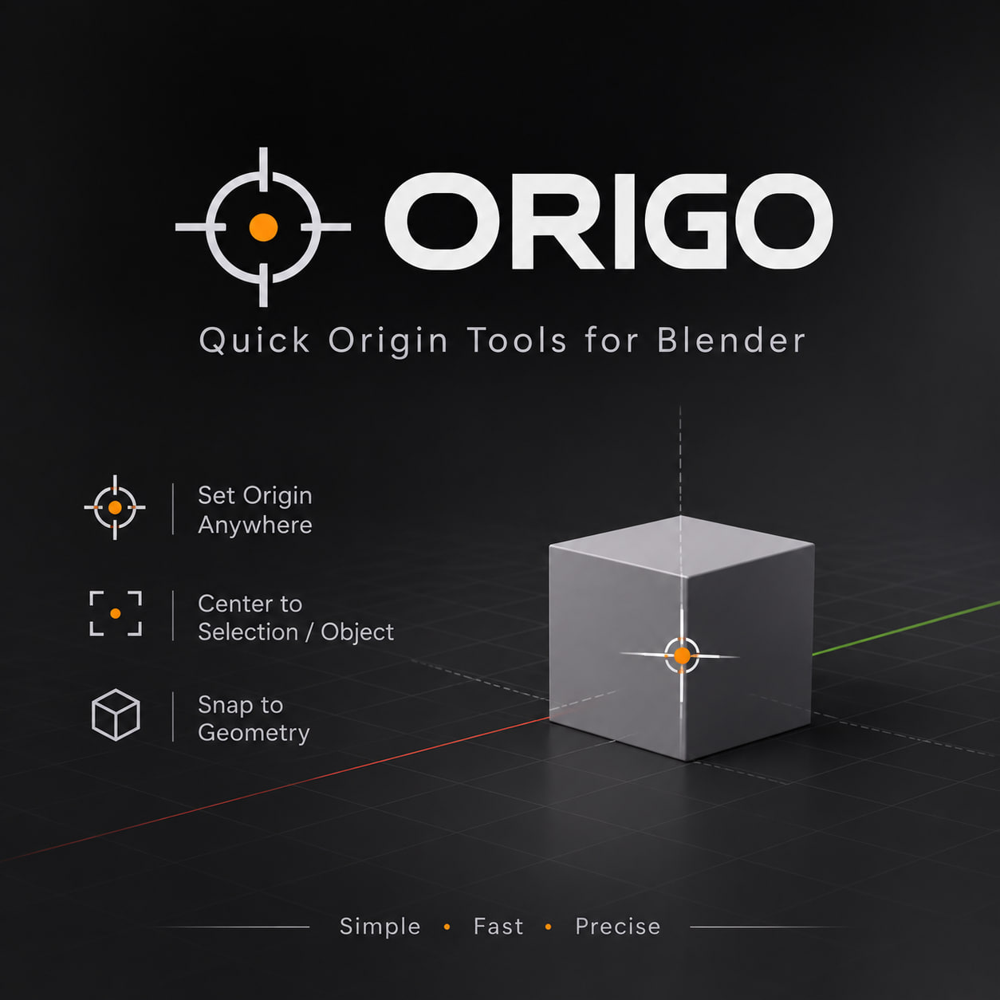

# Origo

**Quick Origin Tools for Blender**

Simple • Fast • Precise

[Download latest release](https://github.com/WilmaStudio/Origo/releases/latest) ·
[All releases](https://github.com/WilmaStudio/Origo/releases) ·
[Report an issue](https://github.com/WilmaStudio/Origo/issues)

---

## What is Origo?

**Origo** (formerly *Origin Studio*) is a free, open-source add-on that makes moving object origins and snapping the 3D cursor a one-click job. Everything lives in one sidebar tab — press **N** in the 3D viewport and open **Origo**.

| Panel | Mode | What it does |
|---|---|---|
| **Origin** | Object | Per-axis origin placement with World/Local space, plus quick presets |
| **3D Cursor** | Object + Edit | Big "Cursor to Selection" button, origin-to-selection in Edit Mode |
| **Drop to Surface** | Object | Drops selected objects onto the surface / ground below (shortcut: **V**) |
| **Randomize** | Object | Live, seeded, reproducible scattering of the selection |

## Features

### Origin — Object Mode
- **World / Local** space toggle. World = the real top/bottom of the object in the scene; Local = follows the object's own rotation.
- **Three buttons per axis**:
  - X: `Left / Center / Right`
  - Y: `Front / Center / Back`
  - Z: `Bottom / Middle / Top`
- The last pressed button **stays lit**, so you always know where the origin currently sits on each axis. The Quick presets light the matching buttons too.
- **Quick presets**: `Center`, `Ground` (bottom-center), `Top`, `Median`, `3D Cursor`, `World 0,0,0`.
- Only the clicked axis moves — the other two keep their position.
- Runs on **all selected objects** at once.
- Visual-safe: geometry never jumps, direct children keep their place, multi-user data is made single-user automatically.
- Works with Mesh, Curve, Surface and Text objects (modifiers are evaluated).

### 3D Cursor — Object & Edit Mode
- One **big "Cursor to Selection" button** (2.6× height — easy to hit).
- Choose what the cursor targets: **Median / Bounds / Active**.
- **Origin to Selection** in Edit Mode: set the origin to the selected vertices / edges / faces and stay in Edit Mode.
- `Cursor to World Center` for a quick reset.

### Drop to Surface — Object Mode
- **Drop (V)**: lands the selected objects on the surface below them (BVH ray-casting against the visible geometry).
- **Surface / Ground** modes: *Surface* = land on real objects below; *Ground* = land on a flat plane at a chosen world Z.
- **More Options** — kept deliberately minimal:
  - **Only on** — restrict landing to one specific object.
  - **Contact** — `Mesh Contact` (accurate), `Bounding Box` (fast) or `Origin`.
- Extras: **Align to Surface Normal**, **Collide with Selection** (stack objects on each other), hotkey **V**.

### Randomize — live, seeded, reproducible
- Just change the **Seed** number and watch the selected objects re-scatter **live** — no "apply" step, no accumulation.
- Toggles: **Location / Rotation / Scale** — only the enabled ones are randomized.
- Same seed → same result, every time (deterministic per object).
- **Reset** restores the exact transforms from before randomizing.

## Installation

### Origo 1.1 — Extension ZIP (Blender 5.2+)
1. Download `Origo-1.1.0.zip` from the [latest release](https://github.com/WilmaStudio/Origo/releases/latest). Do **not** unzip it.
2. In Blender: `Edit ▸ Preferences ▸ Get Extensions`.
3. Open the arrow menu next to the search box and pick **Install from Disk** — or simply drag & drop the ZIP onto the Blender window.
4. Press **N** in the 3D viewport and open the **Origo** tab.

### Origin Studio 1.0 — legacy `.py` (Blender 4.2 – 4.5)
1. Download [`legacy/origin_studio.py`](legacy/origin_studio.py) (or the v1.0.0 release asset).
2. In Blender: `Edit ▸ Preferences ▸ Add-ons ▸` arrow menu `▸ Install Legacy Add-on…`.
3. Enable **Origin Studio**.

> ⚠️ Legacy add-on installation was **removed in Blender 5.x**. On 5.2 use the extension ZIP.

## Compatibility

| Blender | Package | Install method |
|---|---|---|
| 5.2 LTS | `Origo-1.1.0.zip` | Get Extensions ▸ Install from Disk |
| 4.2 – 4.5 | `legacy/origin_studio.py` (v1.0) | Add-ons ▸ Install Legacy Add-on |
| < 4.2 | — | not supported |

## Changelog

### 1.1.0 — Origo
- Renamed **Origin Studio → Origo** (new sidebar tab, operator ids and settings paths).
- Per-axis buttons now **stay lit** after being pressed; the Quick presets update the lights as well.
- Removed the helper captions under the rows for a cleaner panel.
- **Drop to Surface** reworked: *More Options* now keeps only **Only on** and **Contact** (visible in Surface mode).
- **Randomize** rebuilt from scratch: a single live **Seed** + **Location / Rotation / Scale** checkboxes (only enabled ones are randomized) + **Reset**.

### 1.0.0 — Origin Studio
- Initial release: per-axis origin placement (World/Local, Top/Mid/Down), quick presets Ground/Center, big Edit-Mode "Cursor → Selection" button.

## How the origin move works (for the curious)
Origo computes the requested point on the object's **evaluated** geometry (modifiers included), temporarily moves the 3D cursor there and runs Blender's own `origin_set(type='ORIGIN_CURSOR')` — then restores the cursor and selection. Result: one undo step per click, nothing jumps, children stay put.

## Repository layout
- `origo/` — extension package (`blender_manifest.toml` + `__init__.py`), targets Blender 5.2.
- `legacy/origin_studio.py` — single-file legacy add-on for Blender 4.2 – 4.5.
- `docs/` — artwork.

## License
GPL-3.0-or-later — see [LICENSE](LICENSE).

---

## مستندات فارسی

**Origo** (نام قبلی: Origin Studio) یک افزونهٔ رایگان و متن‌باز برای تغییر سریع اورجین آبجکت‌ها در بلندر است. در ویوپورت کلید **N** را بزنید و تب **Origo** را باز کنید.

### نصب (بلندر ۵.۲)
1. فایل `Origo-1.1.0.zip` را از [آخرین Release](https://github.com/WilmaStudio/Origo/releases/latest) دانلود کنید و بازش نکنید.
2. در بلندر: `Edit ▸ Preferences ▸ Get Extensions`.
3. از منوی فلشِ کنار جعبهٔ جستجو **Install from Disk** را بزنید و همان ZIP را انتخاب کنید — یا ZIP را مستقیم روی پنجرهٔ بلندر درگ‌اندروپ کنید.
4. کلید **N** را بزنید و تب **Origo** را باز کنید.

### امکانات در یک نگاه
- **Origin**: انتخاب World/Local و سه دکمه برای هر محور (X: Left/Center/Right — Y: Front/Center/Back — Z: Bottom/Middle/Top). دکمهٔ انتخاب‌شده **روشن می‌ماند** و پریست‌های Quick هم چراغ‌ها را به‌روز می‌کنند.
- **3D Cursor**: دکمهٔ بزرگ «Cursor to Selection» به‌همراه حالت‌های Median/Bounds/Active و «Origin to Selection» در Edit Mode.
- **Drop to Surface**: نشاندن آبجکت‌ها روی سطح زیرشان (کلید **V**) — در More Options فقط **Only on** و **Contact** مانده‌اند.
- **Randomize**: فقط یک **Seed** که با تغییرش چیدمان به‌صورت لایو عوض می‌شود، به‌همراه تیک‌های Location / Rotation / Scale (فقط فعال‌ها رندوم می‌شوند) و دکمهٔ **Reset**.

### نصب Legacy برای بلندر ۴.۲ تا ۴.۵
فایل [`legacy/origin_studio.py`](legacy/origin_studio.py) را دانلود و از طریق `Add-ons ▸ Install Legacy Add-on` نصب کنید (در بلندر ۵ به بعد این روش حذف شده است).
